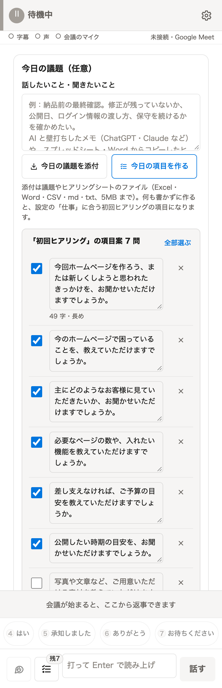
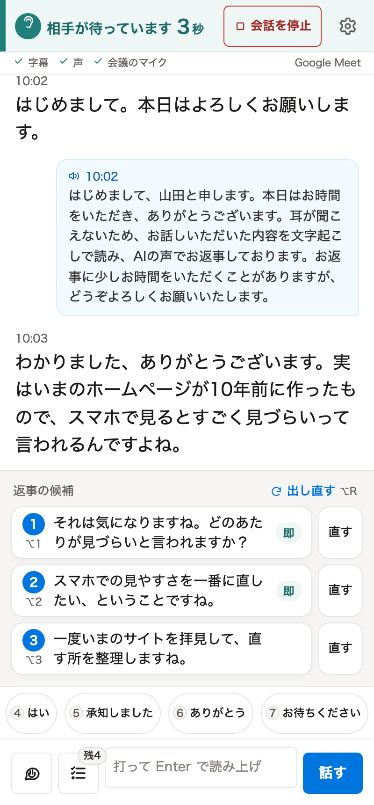
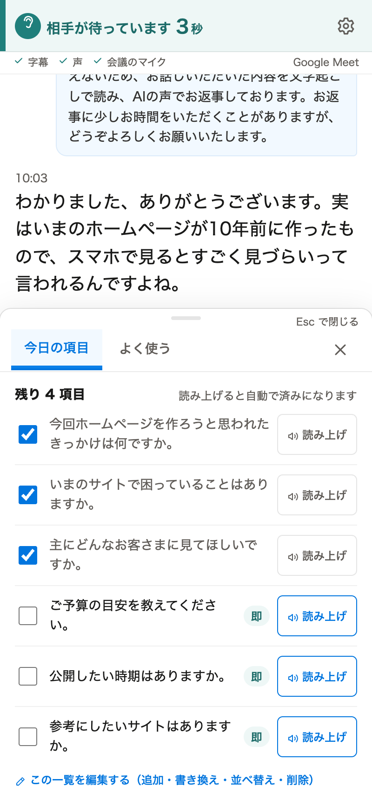
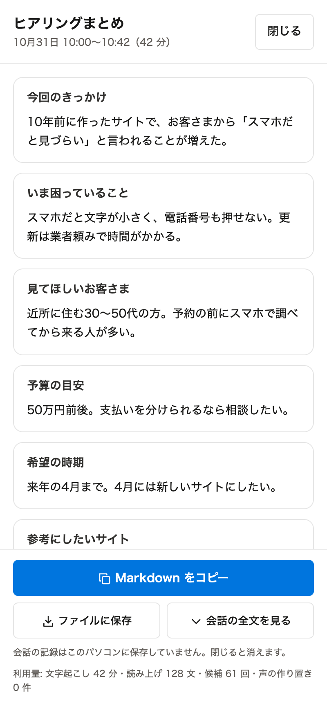

# フキダシ v1.2.4

（旧名: こえブリッジ。英字表記は Fukidashi）

Google Meet の相手の声を字幕で読み、選んだ文・打った文を AI の声で会議のマイクへ送る Chrome 拡張です。相手の方は、何も入れる必要がありません。Zoom のブラウザ版はベータです。

耳が聞こえない・聞こえにくい方、声で話すことが難しい方の会議のために作りました。相手の声は字幕で読み、こちらは打った文を AI の声で話します。聞こえる方・話せる方が、ヒアリングで聞くことの一覧を見ながら進めるのにも使えます。

左から、会議の前の準備、会議中、今日の項目、会議のあとのまとめです（画面は架空の試験データ）。

## できること

- **字幕**: 相手の声を日本語の字幕にします。Google Meet では、話した人の名前も出ます。
- **AI の声で話す**: 打った文・選んだ文を、AI の声（OpenAI の gpt-realtime）で会議のマイクへ送ります。
- **返事の候補・相づち・定型文**: 相手の話に合う返事を3つ出します。「はい」「承知しました」などの相づちや、よく使う文も1回押すだけで読み上げます。
- **今日の項目**: 会議で聞くこと・確認することの一覧です。読み上げると済みの印が付きます。
- **会議の前の準備**: 議題のメモやヒアリングシート（Excel・Word など）から、今日の項目の案を AI に作らせて入れておけます。
- **会議のあとのまとめ**: 項目ごとの答えと会話の全文を、Markdown でコピー・ファイルに保存できます。
- **自分の API キーで動く**: あなたの OpenAI の API キーを入れて使います。通信先は OpenAI だけです。

## 推奨環境

| 項目 | 推奨 |
|---|---|
| パソコン | Mac または Windows のパソコン。スマートフォン・タブレットでは使えません（Chrome の拡張機能が動かないため） |
| ブラウザ | Google Chrome の最新版（116 以降が必須）。Edge・Safari などほかのブラウザでは試していません |
| 会議 | Google Meet を Chrome で開いて参加します。Meet のスマホアプリでは使えません。Zoom はブラウザ版だけで、ベータです |
| 会議の言語 | 日本語の会話（字幕は日本語で文字にします） |
| 話した人の名前 | Meet の画面に参加者のタイルが出ていること。「別のウィンドウで開く」にしていても取れます。Zoom では出ません |
| OpenAI | ご自身の OpenAI の API キー。字幕・AI の声・返事の候補・まとめ・項目づくりに、使った分の利用料がかかります |
| 通信 | 会議中は字幕と声のために OpenAI と通信し続けます。安定した回線を使ってください |

試したのは macOS の Chrome です。Windows の Chrome での動作は、まだ確かめていません。

## 入れ方

Chrome ウェブストアには公開していません。手元で組み立てて読み込みます。Node.js 22 が必要です（ビルドに外部パッケージのインストールは不要です）。

1. このリポジトリを手元に置き（`git clone` または「Code」→「Download ZIP」）、そのフォルダで `npm run build` を実行します。`dist/prod` ができます。
2. Chrome で `chrome://extensions` を開き、右上の「デベロッパー モード」を ON にします。
3. 「パッケージ化されていない拡張機能を読み込む」で `dist/prod` を選びます。**リポジトリのいちばん上のフォルダは選びません。**
4. ツールバーのパズルのアイコンから「フキダシ」をピンで固定します。
5. 拡張を入れる前から開いていた会議のページは、再読み込みします。

画像つきの手順は [マニュアルの「入れる」](docs/MANUAL.md#3-入れる) にあります。

## 使い方の要点

1. **初回設定**: 会議のタブでフキダシのアイコンを押すと、右にパネルが開きます。初回は「API キー → あなたのこと → 声」の3歩です。必須は API キーだけです。
2. **会議の前**: パネルの「今日の議題」に話したいことを書くか、ヒアリングシートを添付して「今日の項目を作る」を押します。案から選んで、今日の項目に入れます。
3. **会議を始める**: Meet に参加してマイクのミュートを解除し、パネルの「開始」を押します。「字幕・声・会議のマイク」の3つがつながると話せます。あなたの本物のマイクの音は、既定では会議に送りません。
4. **会議中**: 字幕を読み、返事の候補・相づち・入力欄・今日の項目のシートから話します。Esc で読み上げを止めます。
5. **会議のあと**: 右上の「会話を停止」で、まとめができます（会話を始めると、歯車の左に出ます）。「Markdown をコピー」か「ファイルに保存」で残します。閉じると記録は消えます。

**使い方のコツ**: フキダシの画面を相手に画面共有しながら進めると、こちらが何を聞こうとしているのかが伝わりやすくなります。共有すると、返事の候補も相手に見えます。

はじめの一言（会議の最初に読み上げる挨拶）では、AI の声で話す理由を相手に伝えます。初回設定か設定の「会議での伝え方」で、「耳が聞こえない・聞こえにくい」「声で話すことが難しい」「どちらも」「理由は伝えない」から選ぶと、文が変わります。文は自分で書き換えることもできます。

## プライバシーと利用料

- 通信先は OpenAI だけです。API キーはこのパソコンの Chrome の中にだけ保存し、会議のページには渡しません。
- 会話の記録は、既定ではメモリの中だけです。閉じると消えます。設定で「7 日間だけ保存する」も選べます。会議の音声を録音する機能はありません。
- 利用料はあなたの OpenAI のアカウントに、使った分だけかかります。返事の候補の声の先読みや、今日の項目・定型文の声の作り置き（20件まで）も含みます。金額はパネルに表示しないので、OpenAI の Usage の画面で確かめてください。
- OpenAI 側のデータの扱いは [公式の説明](https://developers.openai.com/api/docs/guides/your-data) を見てください。

## 文書

| 文書 | 内容 |
|---|---|
| [docs/MANUAL.md](docs/MANUAL.md) | 利用者向けマニュアル。入れ方・設定・会議の前と最中とあと・困ったとき |
| [docs/setup-guide.md](docs/setup-guide.md) | AI に読ませる設定手順。手元の AI（ChatGPT・Claude など）に渡すと、画像を見せながら1手順ずつ案内します |
| [CHANGELOG.md](CHANGELOG.md) | 版ごとの変更 |
| [docs/dev/README-dev.md](docs/dev/README-dev.md) | 開発者向け（構成・ビルド・試験） |
| [THIRD_PARTY_NOTICES.md](THIRD_PARTY_NOTICES.md) | 第三者ライセンス |
| [LICENSE](LICENSE) | このリポジトリのライセンス（MIT） |

AI に設定を手伝ってもらうときは、このリポジトリ（または [AGENTS.md](AGENTS.md)・[llms.txt](llms.txt)）を AI に読ませて、「この Chrome 拡張の入れ方を教えて」と頼んでください。API キーは AI に貼らず、ご自身でパネルに入れてください。

## ライセンス

MIT License です。無料で使え、改変・再配布もできます。くわしくは [LICENSE](LICENSE) を見てください。同梱している第三者のコードのライセンスは [THIRD_PARTY_NOTICES.md](THIRD_PARTY_NOTICES.md) にあります。
