# フキダシ 利用者向けマニュアル（v1.2.2）

フキダシは、Google Meet の相手の声を字幕にし、あなたが選んだ文・打った文を AI の声で会議に届ける Chrome 拡張です。相手の方は、何も入れる必要がありません。

このマニュアルでは、入れ方から会議のあとまでを順に説明します。画面の画像は、架空の会議（Web デザイナーの山田さんが、お客様の佐藤さんにヒアリングする場面）の試験データで撮ったものです。

AI（ChatGPT・Claude など）に設定を手伝ってもらうときは、[AI 向けの設定手順](setup-guide.md) を読ませてください。

## 目次

1. [フキダシでできること](#1-フキダシでできること)
2. [使える環境](#2-使える環境)
3. [入れる](#3-入れる)
4. [パネルを開く](#4-パネルを開く)
5. [初回設定](#5-初回設定)
6. [会議の前の準備](#6-会議の前の準備)
7. [会議を始める](#7-会議を始める)
8. [会議中の使い方](#8-会議中の使い方)
9. [会議のあと](#9-会議のあと)
10. [設定](#10-設定)
11. [困ったとき](#11-困ったとき)
12. [プライバシーと利用料](#12-プライバシーと利用料)
13. [新しい版にする](#13-新しい版にする)

## 1. フキダシでできること

| できること | 説明 |
|---|---|
| 相手の声を字幕で読む | 会議の相手の声を、Chrome の横のパネルに日本語の字幕で出します。Google Meet では、話した人の名前も出ます |
| AI の声で話す | 打った文・選んだ文を、AI の声（OpenAI の音声モデル）で会議のマイクに送ります。相手には普通の参加者の声として聞こえます |
| 返事の候補 | 相手の話に合う返事を3つ出します。押すとすぐ読み上げます |
| 相づち・定型文 | 「はい」「承知しました」などの相づちと、よく使う文を1回押すだけで読み上げます |
| 今日の項目 | 会議で聞くこと・確認することの一覧です。読み上げると、済みの印が付きます |
| 会議の前の準備 | 議題のメモやヒアリングシートから、今日の項目を AI に作らせて入れておけます |
| 会議のまとめ | 会議のあと、項目ごとの答えと会話の全文を Markdown でコピー・保存できます |

耳が聞こえない・聞こえにくい方、声で話すことが難しい方の会議のために作りました。相手の声は字幕で読み、こちらは打った文を AI の声で話します。聞こえる方・話せる方が、ヒアリングで聞くことの一覧を見ながら進めるのにも使えます。

## 2. 使える環境

| 項目 | 必要なもの |
|---|---|
| パソコン | Mac または Windows。スマートフォン・タブレットでは使えません（Chrome の拡張機能が動かないため） |
| ブラウザ | Google Chrome の最新版（116 以降が必須）。Edge・Safari などでは試していません |
| 会議 | Google Meet を Chrome で開いて参加します。Meet のスマホアプリでは使えません。Zoom はブラウザ版だけで、ベータです |
| 会議の言語 | 日本語の会話 |
| 話した人の名前 | Meet の画面に参加者のタイルが出ていること。「別のウィンドウで開く」にしていても取れます。Zoom では出ません |
| OpenAI | ご自身の OpenAI の API キー。使った分の利用料がかかります（[12 章](#12-プライバシーと利用料)） |
| 通信 | 会議中は OpenAI と通信し続けます。安定した回線を使ってください |
| 入れるとき | Node.js 22（拡張を組み立てる `npm run build` に使います） |

試したのは macOS の Chrome です。Windows の Chrome での動作は、まだ確かめていません。

## 3. 入れる

Chrome ウェブストアには公開していません。ファイルを手元で組み立ててから、Chrome に読み込みます。

### 3.1 ファイルを用意して組み立てる

1. [Node.js](https://nodejs.org/) の 22 を入れます（入っていれば不要です。ターミナルで `node -v` と打つと版が分かります）。
2. このリポジトリを手元に置きます。`git clone` するか、GitHub の「Code」→「Download ZIP」で落として展開します。
3. ターミナルで、そのフォルダに移って次を実行します。外部のパッケージを入れる必要はありません。

   ```sh
   npm run build
   ```

4. フォルダの中に `dist/prod` ができます。これが Chrome に読み込むフォルダです。

### 3.2 Chrome に読み込む

1. Chrome のアドレスバーに `chrome://extensions` と入れて開きます。
2. 右上の「デベロッパー モード」を ON にします。

   

3. 左上に出た「パッケージ化されていない拡張機能を読み込む」を押し、`dist/prod` フォルダを選びます。リポジトリのいちばん上のフォルダは選びません。

   

4. 一覧に「フキダシ」のカードが出れば、読み込めています。右下のスイッチが ON になっていることを確かめます。ID はパソコンごとに違います。ボタンの色は Chrome のテーマで変わります。

   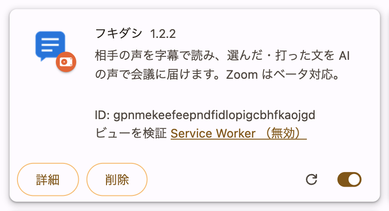

5. Chrome のツールバーの右にあるパズルの形のアイコン（拡張機能）を押し、「フキダシ」の横のピンを押して、ツールバーに固定します。

### 3.3 会議のページを開き直す

拡張を入れる前から開いていた会議のページは、再読み込みしてください。開き直さないと、AI の声を会議に送れません。

## 4. パネルを開く

Google Meet の会議のタブを開き、ツールバーの「フキダシ」のアイコンを押します。Chrome の右側にフキダシのパネルが開きます。

会議でないタブで開いたときは、次のような画面になります。下の図のとおり、ツールバーのパズルの隣にあるフキダシのアイコンを、会議のタブで押してください。この画面でも、上の「今日の議題」で会議の前の準備ができます（[6 章](#6-会議の前の準備)）。

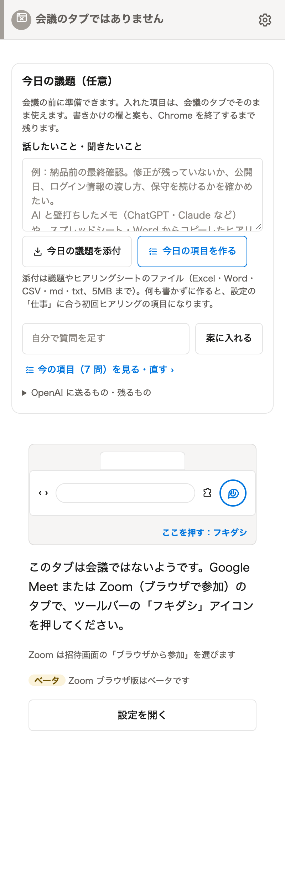

Zoom で使うときは、招待画面で「ブラウザから参加」を選びます。Zoom のブラウザ版はベータです。

## 5. 初回設定

初めてパネルを開くと、3つの手順の初回設定が出ます。必須なのは API キーだけです。

### 5.1 OpenAI の API キーを入れる（1 / 3）

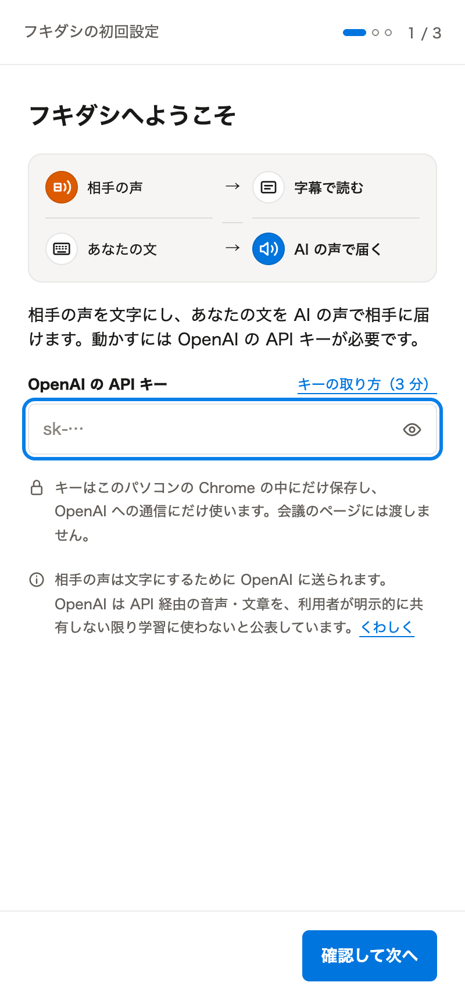

キーを持っていないときは、次の手順で作ります。画面の「キーの取り方（3 分）」からも、OpenAI のキーの画面を開けます。

1. [OpenAI のサイト](https://platform.openai.com/) にサインインします。アカウントが無ければ作ります。
2. 支払い方法を登録し、利用料に使うクレジットを入れます（OpenAI の Billing の画面）。
3. [API keys の画面](https://platform.openai.com/api-keys) で「Create new secret key」を押し、キーを作ります。
4. 出てきたキー（`sk-` で始まる長い文字列）をコピーします。キーはこのときしか表示されないので、なくさないようにしてください。
5. フキダシの欄に貼り付け、「確認して次へ」を押します。OpenAI につながるかを確かめてから次へ進みます。

OpenAI の画面の名前や順番は変わることがあります。そのときは OpenAI の画面の案内に従ってください。キーは他人に渡さないでください。AI に設定を手伝ってもらうときも、キーを AI に貼り付けないでください。

キーはこのパソコンの Chrome の中にだけ保存し、OpenAI への通信にだけ使います。会議のページには渡しません。

### 5.2 あなたのこと（2 / 3）

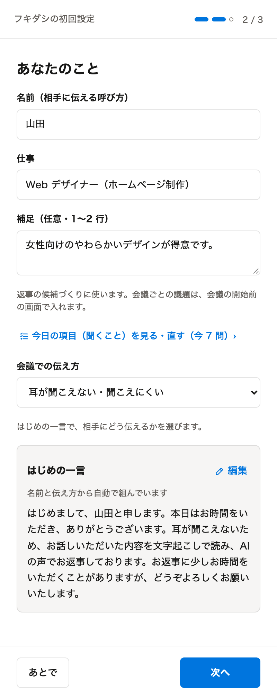

- **名前**: 相手に伝える呼び方です。
- **仕事**: 返事の候補づくりと、今日の項目づくりに使います。
- **補足**: 得意なことなどを1〜2行で。返事の候補づくりに使います。
- **会議での伝え方**: はじめの一言で、AI の声で話す理由を相手にどう伝えるかを選びます。
- **はじめの一言**: 会議の最初に読み上げる挨拶です。名前と伝え方から自動で組み立てます。

| 会議での伝え方 | はじめの一言に入る説明 |
|---|---|
| 耳が聞こえない・聞こえにくい（既定） | 耳が聞こえないため、お話しいただいた内容を文字起こしで読み、AI の声でお返事しております |
| 声で話すことが難しい | 声で話すことが難しいため、入力した文を AI の声で読み上げてお返事しております |
| どちらも | 耳が聞こえず、声で話すことも難しいため、お話しいただいた内容を文字起こしで読み、入力した文を AI の声で読み上げてお返事しております |
| 理由は伝えない | 入力した文を AI の声で読み上げてお返事しております |

どれもあなたの使い方に合わないときは、右上の「編集」で書き換えてください。自分で書き換えた文は、伝え方を変えても上書きしません。あとから設定の「会議での伝え方」「はじめの一言（読み上げ）」でも直せます。

ここは空のまま「あとで」で進んでもかまいません。

### 5.3 あなたの代わりに話す声（3 / 3）

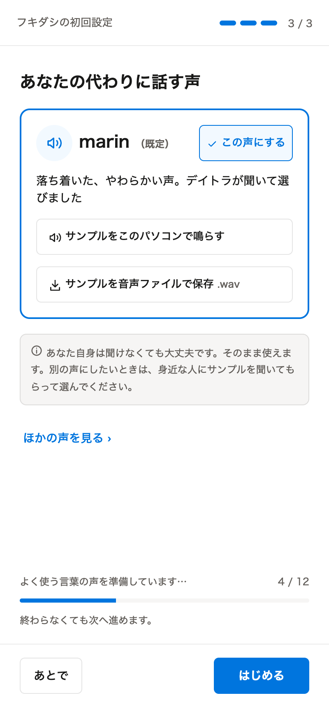

AI の声を選びます。既定は marin です。「サンプルをこのパソコンで鳴らす」で聞けます。あなた自身が聞けなくても、そのまま使えます。別の声にしたいときは、「ほかの声を見る」から身近な人に聞いてもらって選んでください。

下の「よく使う言葉の声を準備しています」は、相づちなどの声を先に作っている表示です。終わらなくても次へ進めます。「はじめる」を押すと、初回設定は終わりです。

## 6. 会議の前の準備

会議で聞くこと・確認することを、「今日の項目」として先に入れておけます。準備は任意です。何もしなくても、既定の7問（初回ヒアリングの質問）が入っています。

### 6.1 今日の議題から項目を作る

パネルの「今日の議題（任意）」の欄に、話したいこと・聞きたいことを書いて、「今日の項目を作る」を押します。AI が、相手に読み上げる質問の案を作ります。

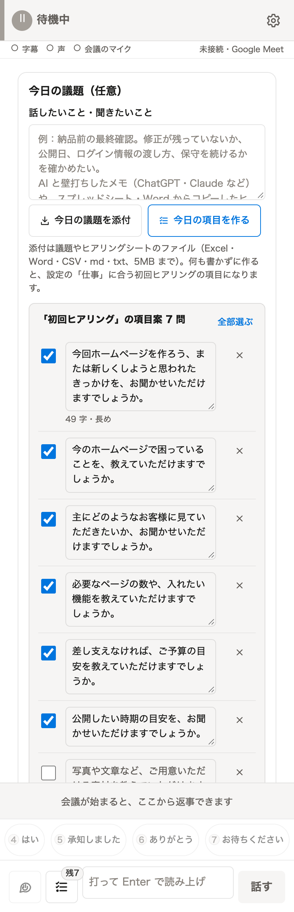

- 欄には、自由に書いたメモのほか、ChatGPT・Claude などと相談したメモや、スプレッドシート・Word からコピーしたヒアリングシートをそのまま貼り付けられます。
- 何も書かずに作ると、設定の「仕事」に合う初回ヒアリングの項目を作ります。
- 案の文はその場で直せます。要らない問は右の「×」で消します。
- 「自分で質問を足す」欄に書いて「案に入れる」を押すと、自分の質問も案に入れられます。
- 会議のタブでない画面でも準備できます。書きかけの欄と案は、Chrome を終了するまで残ります。

案の下で、入れ方を選びます。

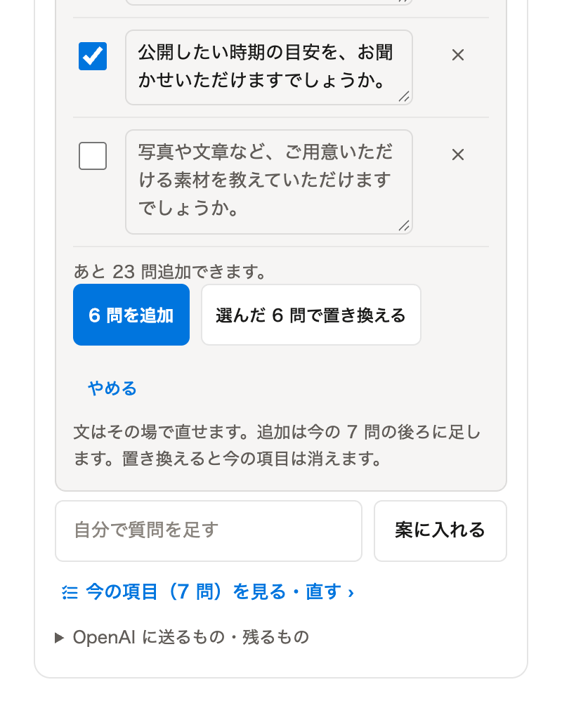

- **N 問を追加**: チェックを付けた案を、今の項目の後ろに足します。
- **選んだ N 問で置き換える**: 今の項目を消して、選んだ案だけにします。
- **やめる**: 案を閉じます。

今日の項目は30問までです。「あと N 問追加できます」と出るので、満杯のときは一覧で整理するか、置き換えてください。入りきらなかった案は消さずに残します。1問は45字（読み上げて10秒）以内が目安です。長い問には「長め」と出ます。

### 6.2 ヒアリングシートを添付する

完成済みのヒアリングシートがあれば、「今日の議題を添付」で選びます。空欄の項目だけを埋めるための質問を作ります。

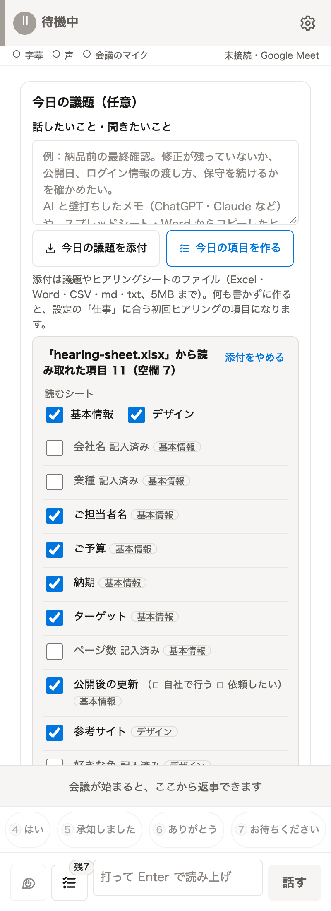

- 読める形式は .xlsx・.docx・.csv・.tsv・.md・.txt です（5MB まで・読み取る文字は先頭から2万字まで）。
- 読み取れた項目の一覧が出ます。要らない項目のチェックを外します。Excel は、読むシートも選べます。記入済みの項目には「記入済み」と出ます。
- 似た項目はまとめ、最大20問を作ります。空欄が1〜2項目なら、その数だけ作ります。
- ファイルは拡張の中で読み、外へアップロードしません。OpenAI に送るのは、選んだ項目の名前と選択肢だけです。記入済みの値やファイルの中身は送らず、保存もしません。
- 表の見出し（No.・項目・回答／記入欄・備考 など）から、どの列が項目でどの列が記入欄かを決めます。見出しが無く決められない表は、読み取った列を見せて「項目の列」「記入欄の列」を選んでもらいます。

読めないもの: PDF・画像・旧形式の .xls / .doc・パスワード付きのファイル（選ぶとエラーが出ます）。結合セル・チェックボックスの部品・画像・図形・テキストボックスの中の文字、入れ子の表、数式の結果が保存されていないセルは、読めないことがあります。Google スプレッドシート・ドキュメントは、.xlsx / .docx でダウンロードするか、表をコピーして欄に貼り付けてください。

### 6.3 今の項目を見る・直す

「今の項目（N 問）を見る・直す」で、今日の項目の一覧を開きます。追加・書き換え・並べ替え・削除ができます。変更はすぐに保存されます。

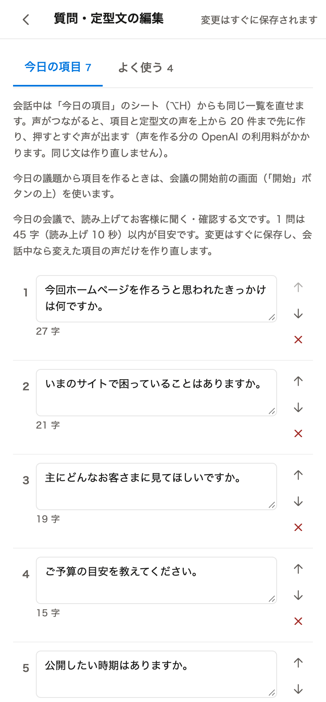

- 「よく使う」の札では、定型文（会議中によく使う文）を同じように編集できます。
- 保存に失敗したときは、入力を残したまま案内が出ます。閉じても、開き直すと入力が戻り、「もう一度保存する」で保存できます。

「今日の項目を作る」は、作るたびに OpenAI の利用料がかかります。

## 7. 会議を始める

1. Google Meet の会議に参加します。Meet がマイクの使用を求めたら、許可します。
2. Meet のマイクのミュートを解除します。
3. 会議のタブで、ツールバーの「フキダシ」のアイコンを押します（パネルを開いていても、会議のタブで押し直すと確実です）。
4. パネルの「開始」を押します。

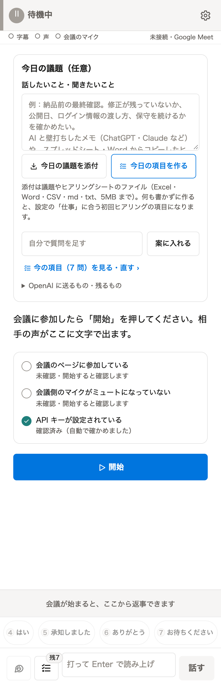

開始すると、「字幕」「声」「会議のマイク」の3つの接続を確かめます。3つともつながると、パネルの上に「✓ 字幕 ✓ 声 ✓ 会議のマイク」と出て、返事ができるようになります。

- 「会議の画面を一度クリックすると声を送れます」と出たら、Meet の画面をどこか1回クリックします。
- あなたの本物のマイクの音は、既定では会議に送りません。会議に届くのは AI の声だけです。あなたの声も届けたいときは、設定の「詳細設定」→「本人の実マイクも会議に送る」を ON にします。

## 8. 会議中の使い方

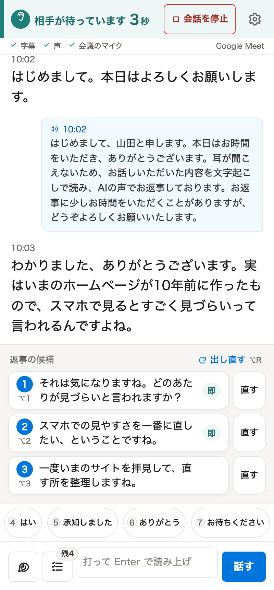

### 8.1 字幕と話した人の名前

- 相手の声は、パネルの中央に字幕で出ます。あなたが AI の声で話した文は、右寄せの青い枠で出ます。
- Google Meet では、字幕の上に話した人の名前（画像の「佐藤」）が出ます。名前は Meet の画面に出ている参加者のタイルから取ります。分からないときは名前を出しません。
- 名前が出ないときは、Meet の画面に参加者のタイルが出ているかを確かめてください。Meet の画面が変わると、名前が出なくなることがあります。字幕は止まりません。
- 上の帯は、今の状態を示します。「相手が待っています 3秒」は、相手が話し終えてからの秒数です。
- 字幕を上へさかのぼって読んでいる間は、勝手に最新へ戻りません。「最新へ」を押すと戻ります。

### 8.2 返事の候補

- 相手が話し終わると、返事の候補が3つ出ます。押すとその文を読み上げます。
- 「即」が付いた候補は、声を先に作り終えています。押すとすぐ声が出ます。
- 「直す」を押すと、その文が下の入力欄に入ります。直してから読み上げられます。
- 「出し直す」で、候補を作り直します。

### 8.3 打って話す

- 下の入力欄に文を打ち、Enter（または「話す」）で読み上げます。
- 日本語変換中の Enter では送りません。Shift+Enter は改行です。
- 相手が待っている間に入力を続けると、6秒で「少々お待ちください。いま入力しています。」と1回送ります（つなぎ。設定で OFF にできます）。

### 8.4 相づち

入力欄の上の4つのボタンが相づちです。短いラベルを押すと、読み上げる文を送ります。

| ボタン | 読み上げる文 |
|---|---|
| はい | はい。 |
| 承知しました | 承知いたしました。 |
| ありがとう | ありがとうございます。 |
| お待ちください | 少々お待ちください。 |

ラベルと文は、設定の「よく使う言葉」で変えられます。

### 8.5 はじめの一言

入力欄の左のボタンを押すと、はじめの一言を読み上げます。会議の最初に、文字起こしと AI の声を使っていることを相手に伝えるのに使います。

### 8.6 読み上げを止める

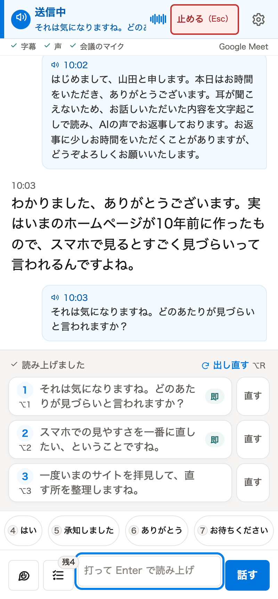

読み上げ中は、上の帯に「送信中」と読み上げている文が出ます。「止める（Esc）」を押すか、Esc キーで止めます。途中で止めた文は、相手に届いた範囲を確かめて記録します。確かめられないときは「読み上げ範囲は未確認」と出ます。

### 8.7 今日の項目のシート

入力欄の左の一覧のボタン（右上に「残り」の数が出ます）を押すと、今日の項目のシートが開きます。

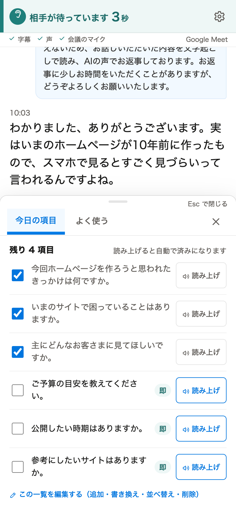

- 「読み上げ」を押すと、その問を読み上げます。読み終えると、チェックが付きます。
- 「即」が付いた問は、声を先に作り置きしてあるので、押すとすぐ鳴ります。会話を始めて声がつながると、今日の項目と定型文の声を、上から合わせて20件まで先に作ります。
- 「よく使う」の札には、定型文（「恐れ入りますが、もう一度お話しいただけますでしょうか。」など）があります。
- 「この一覧を編集する」で、会議中でも追加・書き換え・並べ替え・削除ができます。書き換えた項目の声だけ作り直します。
- Esc でシートを閉じます。

### 8.8 キーボードの操作

| キー | 操作 |
|---|---|
| Alt / Option + 1〜3 | 候補を読む |
| Alt / Option + 4〜7 | 相づち |
| Alt / Option + 0 | はじめの一言 |
| Alt / Option + H | 今日の項目のシート |
| Alt / Option + R | 候補を出し直す |
| Esc | 読み上げ停止／シートを閉じる |
| `/` | 入力欄へ（文章の編集中を除く） |
| Ctrl / Command + ↓ | 最新の字幕へ |

### 8.9 使い方のコツ: パネルを画面共有する

フキダシのパネルを相手に画面共有しながら進めると、こちらが何を聞こうとしているのかが相手に伝わりやすくなります。共有すると、返事の候補も相手に見えます。

## 9. 会議のあと

### 9.1 会話を停止する

右上の「会話を停止」を押します（会話を始めると、歯車のボタンの左に出ます。AI の声で読み上げている間は、代わりに「止める（Esc）」が出ます）。歯車のボタンのメニューからも選べます。確認が出たら「停止」を押します。字幕と声の接続を切り、ここまでの会話をまとめ始めます。

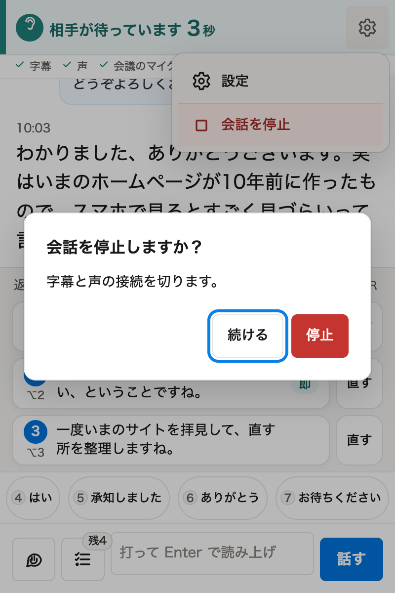

### 9.2 まとめ

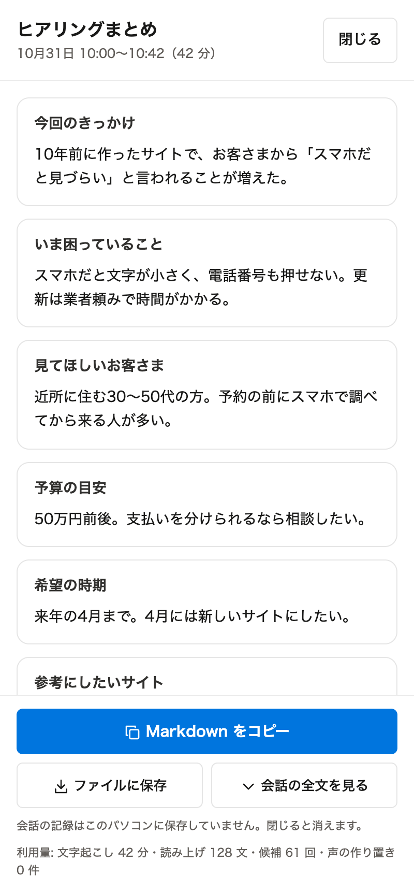

- 今日の項目ごとに、相手の答えをまとめます。会話で出てこなかった項目は「未確認」と出ます。「＋ 次回聞く」を押すと、その問を今日の項目に戻します。
- 項目の後に、「そのほかに出た話」と「次にやること」が続きます。
- **Markdown をコピー**: まとめを Markdown の形でコピーします。まとめができあがると押せます。
- **ファイルに保存**: `フキダシ-YYYY-MM-DD.md` という名前のファイルで保存します。
- **会話の全文を見る**: 字幕と読み上げた文を、時刻と話した人つきで見られます。
- まとめを作れなかったときは「もう一度まとめる」を押します。そのときも、会話の全文は保存できます。

Markdown は次の形です。

```markdown
# ヒアリングまとめ

（日時）

## （今日の項目の問）

（相手の答え）

## そのほかに出た話

- （話題）

## 次にやること

- [ ] （やること）

## 会話の全文

（時刻 話した人: 文）
```

### 9.3 記録はいつ消えるか

会話の記録は、既定ではパソコンのメモリの中だけにあります。まとめの画面で「閉じる」を押す、最後のパネルを閉じる、または Chrome を終了すると消えます。残したいときは、閉じる前にコピーか保存をしてください。

設定の「このパソコンへの会話の保存」を「7 日間だけ保存する」にすると、拡張の中に7日間保存します。保存した記録は、設定の「保存した記録を見る」で開けます。

## 10. 設定

会議中は右上の歯車→「設定」、会議の前はパネルの歯車から開きます。変更はすぐに保存されます。

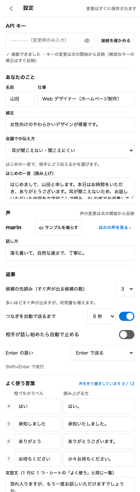

| 項目 | 内容 |
|---|---|
| API キー | キーの入れ直しと「接続を確かめる」。キーの変更は次の開始から反映します（無効なキーの修正はすぐ反映） |
| あなたのこと | 名前・仕事・補足・会議での伝え方・はじめの一言（読み上げ） |
| 声 | 声の種類と話し方（既定「落ち着いて、自然な速さで、丁寧に。」）。次の開始から反映します |
| 返事 | 候補の先読み（すぐ声が出る候補の数。既定3。多いほど利用量が増えます）、つなぎを自動で送るまでの秒数（既定6秒・ON）、相手が話し始めたら自動で止める（既定 OFF）、Enter の扱い |
| よく使う言葉 | 相づち4つのラベルと読み上げる文、定型文の一覧 |
| 今日の項目 | 今日の項目の一覧（1行に1問）。「一覧で編集する」で編集画面を開きます |
| 見え方 | 話した人の名前を出す（既定 ON）、字幕の文字サイズ（16〜28px・既定19px）、ダークモード（自動・明・暗）、画面の動きを止める |
| 記録・保存 | このパソコンへの会話の保存（保存しない（既定）／7 日間だけ保存する）、保存した記録を見る、記録を削除 |
| 詳細設定 | 声の検出のしきい値、文字起こしのモデル、本人の実マイクも会議に送る、会議の音をこのパソコンでも鳴らす、字幕の入力にこのパソコンのマイクを使う（対面用。品質保証の対象外）、マイクの許可画面を開く |

文字サイズ・配色・つなぎ・実マイクの送信などは、会議中に変えてもすぐ効きます。API キー・声・話し方・文字起こしのモデルは、次の開始から反映します。

「話した人の名前を出す」を OFF にすると、今の会話の名前を消し、取得を止めます。保存済みのまとめは変えません。

## 11. 困ったとき

パネルの上に、困っていることが帯で出ます。

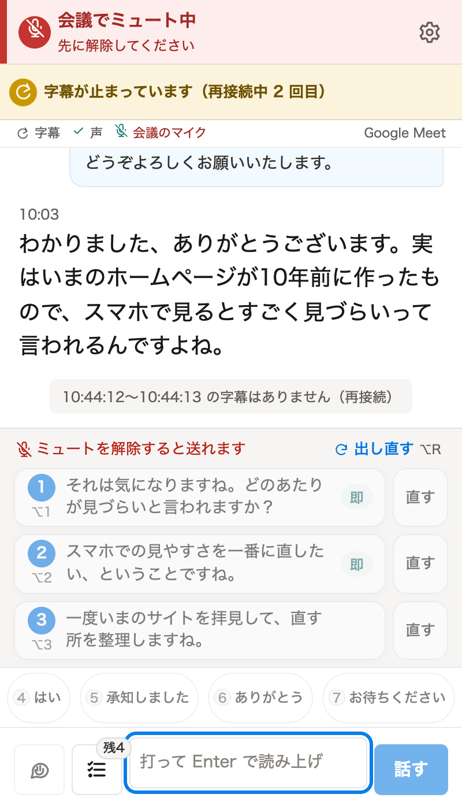

| 出ている表示 | すること |
|---|---|
| 会議のタブではありません | 会議のタブで、ツールバーのフキダシのアイコンを押します |
| Google Meet / Zoom の会議タブで拡張アイコンを押してください／会議タブで拡張アイコンを押し直してください | 会議のタブを前に出し、ツールバーのフキダシのアイコンを押してから「開始」を押します |
| 会議タブの音を取得できません。会議タブで拡張アイコンを押し直してください | 同上 |
| 会議に参加すると声を送れます。参加してもこの表示が消えないときは、会議のページを再読み込みしてください。 | 会議に参加します。参加しても消えないときは、会議のページを再読み込みします（拡張を入れる前から開いていたページで起きます） |
| 会議でミュート中 | Meet のマイクのミュートを解除します。ミュート中は AI の声を送りません |
| 会議の画面を一度クリックすると声を送れます | Meet の画面を1回クリックします |
| 字幕が止まっています（再接続中 N 回目） | 自動でつなぎ直しています。戻ると「字幕が復帰しました」と出て、字幕の無かった時間が字幕の中に書かれます |
| 声を送れません／声の接続が切れました | 帯のボタンでつなぎ直します。回線を確かめてください |
| 会議へ声を送れませんでした。会議のマイクを確認してください | Meet でマイクが許可され、選ばれているかを確かめます |
| API キーが無効です（401）／このキーでは接続できませんでした（401） | 設定でキーを入れ直します。OpenAI の API keys の画面で、そのキーが消されていないかも確かめます |
| 項目を作れませんでした | 今の項目はそのままです。少し待ってからもう一度作ります |

ほかに次のことも確かめてください。

- **ツールバーにアイコンが無い**: パズルのアイコンからフキダシをピンで固定します（[3.2](#32-chrome-に読み込む) の手順5）。
- **字幕が出ない**: 会議のタブでアイコンを押してから開始したかを確かめます。別のタブの音は字幕にしません。
- **話した人の名前が出ない**: Meet に参加者のタイルが出ているかを確かめます。Zoom では名前は出ません。
- **相手に声が届かない**: Meet でマイクが許可されていて、ミュートが解除されているかを確かめます。
- **キーは正しいのに動かない**: OpenAI の Billing の画面で、クレジットが残っているかを確かめます。

## 12. プライバシーと利用料

### 12.1 どこへ何を送るか

フキダシが通信する先は OpenAI だけです。ほかのサーバーへは送りません。

| 送るもの | 使い道 |
|---|---|
| 相手の声（会議のタブの音） | 字幕にする |
| あなたが読み上げる文 | AI の声にする |
| 字幕の文・話した人の名前・仕事・補足・今日の項目 | 返事の候補とまとめを作る |
| 今日の議題の欄・添付から選んだ項目の名前・仕事・補足 | 今日の項目の案を作る（会議の字幕は送りません） |

OpenAI は、API 経由の音声・文章を、利用者が明示的に共有しない限り学習に使わないと公表しています。くわしくは [OpenAI の説明](https://developers.openai.com/api/docs/guides/your-data) を見てください。

### 12.2 このパソコンに残るもの

| もの | 残り方 |
|---|---|
| API キー | このパソコンの Chrome の中にだけ保存します。会議のページには渡しません |
| 設定・定型文・今日の項目 | 拡張の中に保存します |
| 定型文・相づち・今日の項目の作り置きの声 | 拡張の中に保存します |
| 会話の記録 | 既定ではメモリの中だけ。「7 日間だけ保存する」を選んだときだけ拡張の中に保存し、期限が来たら消します。「保存しない」に戻すと、保存済みの記録も消します |
| 返事の候補の声 | その会話の間だけ |
| 今日の議題の欄・項目の案 | Chrome を終了するまでメモリの中だけ。ディスクには書きません |
| 添付したファイル | 保存しません |
| 会議の録音 | 録音する機能はありません |

### 12.3 利用料

フキダシの利用料は、あなたの OpenAI のアカウントに、使った分だけかかります。

- 会議中: 字幕（文字起こし）、AI の声、返事の候補と、候補の声の先読み
- 会話を始めたとき: 今日の項目と定型文の声の作り置き（合わせて20件まで。同じ文の声は作り直しません）
- 会議のあと: まとめ
- 会議の前: 「今日の項目を作る」を押すたび

まとめの画面の下に、その会話の利用量（文字起こしの分数・読み上げた文の数・候補の回数・声の作り置きの数）が出ます。金額は表示しません。料金は [OpenAI の料金表](https://openai.com/api/pricing/) を、実際に使った額は OpenAI の Usage の画面を見てください。使いすぎが心配なときは、OpenAI の設定で予算の上限や通知を決めておくと安心です。

## 13. 新しい版にする

1. 新しいファイルを手元に置きます（`git pull`、または ZIP を落とし直す）。
2. `npm run build` を実行します。
3. `chrome://extensions` のフキダシのカードで、再読み込みのボタン（丸い矢印）を押します。
4. 開いていた会議のページを再読み込みします。

API キー・設定・作り置きの声はそのまま残ります。版ごとの変更は [CHANGELOG](../CHANGELOG.md) にあります。
