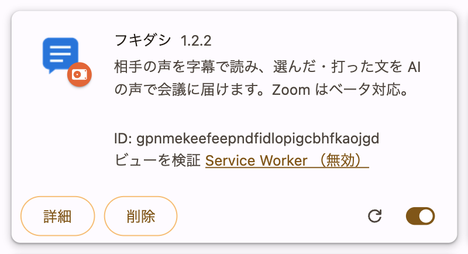
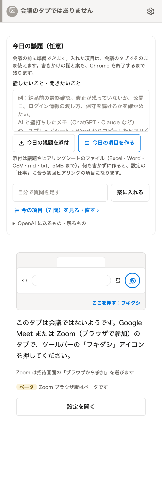
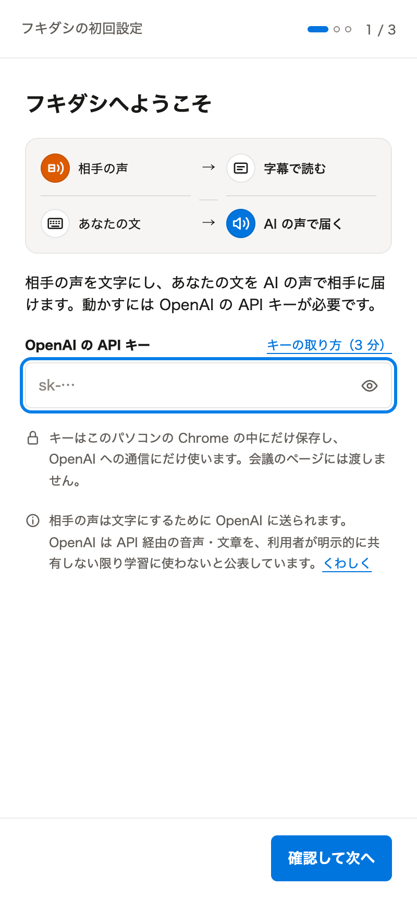
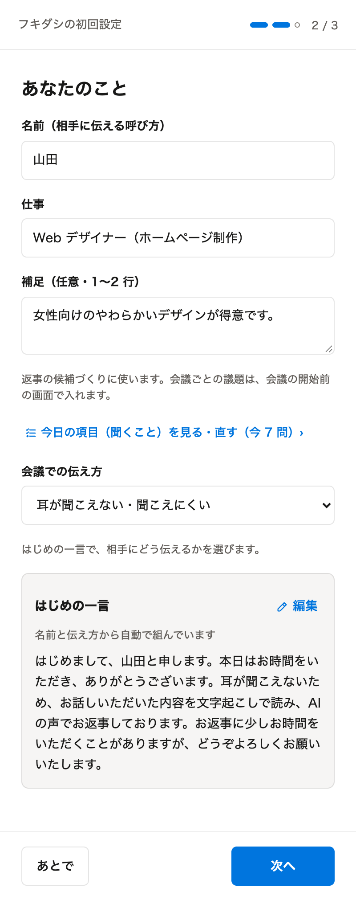
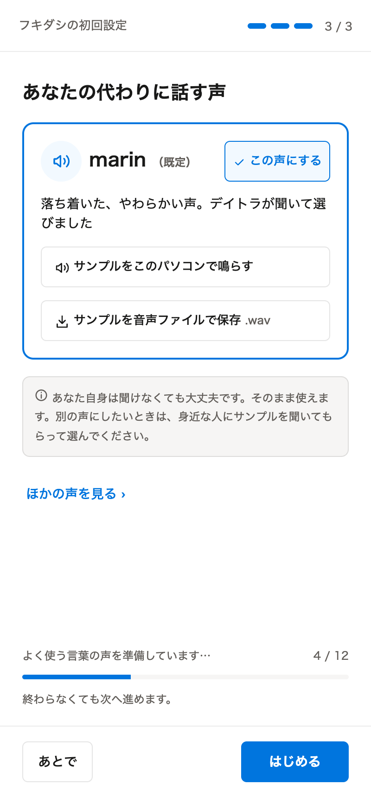
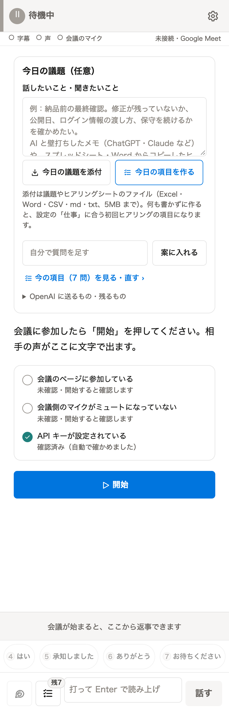

# フキダシ 設定手順（AI が読んで案内するための手順書）


画像の絶対 URL の元: `https://raw.githubusercontent.com/showheyohtaki/fukidashi/main/docs/images/`

---

## この手順書を読む AI へ

あなたは、利用者が Chrome 拡張「フキダシ」を入れて初回設定を終えるまでを案内します。次のとおりに進めてください。

1. **最初に利用者の環境を確かめる。** パソコンが Mac か Windows か、Chrome の版（116 以降が必要）、Node.js が入っているか（22 を推奨）を聞きます。スマートフォン・タブレットでは使えないことも伝えます。
2. **1手順ずつ進める。** 一度に全部を説明しません。各手順で、まず画像を見せ、そのあとに説明し、利用者が「できた」と言ってから次へ進みます。
3. **画像の見せ方。** 各手順の画像は、相対パス（`images/...`。このファイルから見た場所）と絶対 URL の両方を書いています。リポジトリのファイルを読める場合は相対パスの画像を、URL しか使えない場合は絶対 URL の画像を見せてください。画像を表示できない環境では、画像の説明文（各画像の alt と「画像に写っているもの」）を読み上げてください。
4. **API キーは利用者が自分で入れる。** OpenAI の API キーを、あなた（AI）とのチャットに貼らせないでください。キーの作り方は案内しますが、キーの値は聞きません。もし貼られたら、使わずに、OpenAI でそのキーを消して作り直すよう伝えます。
5. **分からないことは推測しない。** この手順書と [利用者向けマニュアル](MANUAL.md) に書いていないことは、「マニュアルに書いていない」と伝えます。Windows での動作は確かめていない点も、聞かれたら正直に伝えます。
6. **コードは変えない。** 設定の案内の途中で、拡張のファイルを書き換えないでください。

設定のあとの使い方（会議の前の準備・会議中・まとめ・困ったとき）は [MANUAL.md](MANUAL.md) にあります。

---

## 手順 0: 環境を確かめる

利用者に次を確かめてもらいます。

- パソコン: Mac または Windows。
- Chrome の版: Chrome のアドレスバーに `chrome://version` と入れると、いちばん上に版が出ます。116 以降が必要です。古ければ Chrome を更新します。
- Node.js: Mac は「ターミナル」、Windows は「PowerShell」を開き、`node -v` と入れます。`v22` で始まる数字が出れば準備できています。出ないときは [Node.js](https://nodejs.org/) から 22 を入れます。
- OpenAI のアカウント: API キーを作るのに使います（手順 9）。

試したのは macOS の Chrome です。Windows の Chrome での動作は、まだ確かめていません。

## 手順 1: ファイルを手元に置く

次のどちらかで、リポジトリを手元のフォルダに置きます。

- git を使う人: `git clone https://github.com/showheyohtaki/fukidashi.git`
- git を使わない人: GitHub のリポジトリの画面で「Code」→「Download ZIP」を押し、落とした ZIP を展開します。

置いたフォルダの場所を、利用者に覚えておいてもらいます。

## 手順 2: 組み立てる（ビルド）

ターミナル（Windows は PowerShell）で、手順 1 のフォルダに移り、次を実行します。

```sh
npm run build
```

`Built dist/prod` と `Built dist/dev` と出れば成功です。フォルダの中に `dist/prod` ができます。外部のパッケージを入れる必要はありません。

`dist/prod` が Chrome に読み込むフォルダです。`dist/dev` は開発用なので使いません。

## 手順 3: Chrome の拡張機能の画面を開く

Chrome のアドレスバーに `chrome://extensions` と入れて開きます。

## 手順 4: デベロッパー モードを ON にする


絶対 URL: https://raw.githubusercontent.com/showheyohtaki/fukidashi/main/docs/images/01-extensions-devmode.png

画像に写っているもの: 拡張機能の画面の右上にある「デベロッパー モード」の文字と、その右のスイッチ（ON の状態）。

右上の「デベロッパー モード」のスイッチを押して ON にします。ON にすると、画面の左上にボタンが3つ出ます。スイッチの色は Chrome のテーマで変わります。

## 手順 5: dist/prod を読み込む


絶対 URL: https://raw.githubusercontent.com/showheyohtaki/fukidashi/main/docs/images/02-extensions-load-unpacked.png

画像に写っているもの: 左から「パッケージ化されていない拡張機能を読み込む」「拡張機能をパッケージ化」「更新」の3つのボタン。

いちばん左の「パッケージ化されていない拡張機能を読み込む」を押し、手順 2 でできた `dist/prod` フォルダを選びます。リポジトリのいちばん上のフォルダは選びません（そこにあるのは組み立てる前のファイルです）。

## 手順 6: 読み込めたか確かめる



絶対 URL: https://raw.githubusercontent.com/showheyohtaki/fukidashi/main/docs/images/03-extensions-card.png

画像に写っているもの: 吹き出しのアイコンと「フキダシ 1.2.2」の名前、説明文、ID、右下の ON のスイッチ。

一覧に「フキダシ」のカードが出て、右下のスイッチが ON なら読み込めています。ID はパソコンごとに違うので、画像と同じでなくてかまいません。カードに赤い「エラー」のボタンが出ているときは、選んだフォルダが `dist/prod` かを確かめます。

## 手順 7: ツールバーに固定する

Chrome のツールバーの右にある、パズルの形のアイコン（拡張機能）を押します。一覧の「フキダシ」の横にあるピンを押すと、ツールバーにフキダシのアイコンが並びます。

この部分は Chrome の外枠なので、画像はありません。手順 8 の画像に、ツールバーの図があります。

## 手順 8: 会議のタブでパネルを開く

拡張を入れる前から開いていた Google Meet のページがあれば、再読み込みしてもらいます。

Google Meet の会議のページを開き、ツールバーのフキダシのアイコンを押します。Chrome の右側にフキダシのパネルが開きます。



絶対 URL: https://raw.githubusercontent.com/showheyohtaki/fukidashi/main/docs/images/04-open-panel.png

画像に写っているもの: 上に「会議のタブではありません」、中ほどに「今日の議題（任意）」の欄、その下にブラウザのツールバーの図（パズルのアイコンの右に丸で囲んだフキダシのアイコンと「ここを押す：フキダシ」の文字）。

会議でないタブで開くと、この画面になります。図のとおり、会議のタブでフキダシのアイコンを押せば会議用の画面になります。初めて開いたときは、先に手順 9 の初回設定が出ます。

## 手順 9: OpenAI の API キーを入れる（初回設定 1 / 3）



絶対 URL: https://raw.githubusercontent.com/showheyohtaki/fukidashi/main/docs/images/05-setup-1-key.png

画像に写っているもの: 「フキダシへようこそ」の見出し、「相手の声 → 字幕で読む」「あなたの文 → AI の声で届く」の図、「OpenAI の API キー」の入力欄（`sk-…`）、「キーの取り方（3 分）」のリンク、「確認して次へ」のボタン。

キーを持っていない利用者には、次の流れを案内します。

1. [OpenAI のサイト](https://platform.openai.com/) にサインインします（アカウントが無ければ作ります）。
2. Billing の画面で支払い方法を登録し、利用料に使うクレジットを入れます。
3. [API keys の画面](https://platform.openai.com/api-keys) で「Create new secret key」を押してキーを作り、表示されたキー（`sk-` で始まる）をコピーします。キーはこのときしか表示されません。
4. フキダシの欄に**利用者自身が**貼り付け、「確認して次へ」を押します。

OpenAI の画面の名前や順番は変わることがあります。そのときは OpenAI の画面の案内に従うよう伝えます。キーの値は AI とのチャットに貼らせません。

「このキーでは接続できませんでした（401）」と出たら、キーのコピー漏れ（前後の空白・一部だけ）を確かめ、だめなら作り直してもらいます。

## 手順 10: あなたのこと（初回設定 2 / 3）



絶対 URL: https://raw.githubusercontent.com/showheyohtaki/fukidashi/main/docs/images/06-setup-2-you.png

画像に写っているもの: 「あなたのこと」の見出し、名前・仕事・補足の欄、「今日の項目（聞くこと）を見る・直す」のリンク、「会議での伝え方」の選択、「はじめの一言」の枠と「編集」のリンク、「あとで」「次へ」のボタン。

名前・仕事・補足を入れます。どれも任意で、「あとで」でも進めます。仕事と補足は、返事の候補と今日の項目づくりに使います。

「会議での伝え方」を利用者に選んでもらいます。選べるのは「耳が聞こえない・聞こえにくい」（既定）、「声で話すことが難しい」、「どちらも」、「理由は伝えない」です。障害や状態を利用者に尋ねて決めつけず、選択肢を読み上げて本人に選んでもらいます。

「はじめの一言」は会議の最初に読み上げる挨拶で、名前と伝え方から自動で組み立てます。利用者の使い方に合わないときは、「編集」で書き換えるよう伝えます。

## 手順 11: 声を選ぶ（初回設定 3 / 3）



絶対 URL: https://raw.githubusercontent.com/showheyohtaki/fukidashi/main/docs/images/07-setup-3-voice.png

画像に写っているもの: 「あなたの代わりに話す声」の見出し、「marin（既定）」と「この声にする」、サンプルを鳴らす・保存するボタン、「ほかの声を見る」のリンク、下に「よく使う言葉の声を準備しています 4 / 12」の進み具合、「はじめる」のボタン。

既定の marin のままでかまいません。「サンプルをこのパソコンで鳴らす」で聞けます。下の進み具合は、相づちなどの声を先に作っている表示で、終わらなくても進めます。「はじめる」を押すと初回設定は終わりです。

## 手順 12: 会議で開始する



絶対 URL: https://raw.githubusercontent.com/showheyohtaki/fukidashi/main/docs/images/11-start.png

画像に写っているもの: 上に「待機中」、「今日の議題（任意）」の欄、「会議に参加したら「開始」を押してください」の文、確認の一覧（会議のページに参加している・会議側のマイクがミュートになっていない・API キーが設定されている）、青い「開始」のボタン。

1. Google Meet の会議に参加し、Meet がマイクの使用を求めたら許可します。
2. Meet のマイクのミュートを解除します。
3. 会議のタブでフキダシのアイコンを押し、パネルの「開始」を押します。
4. パネルの上に「✓ 字幕 ✓ 声 ✓ 会議のマイク」と出れば、使える状態です。

「会議の画面を一度クリックすると声を送れます」と出たら、Meet の画面を1回クリックします。ほかの表示が出たら、[MANUAL.md の「困ったとき」](MANUAL.md#11-困ったとき) を見て案内します。

## 設定のあと

ここまでで設定は終わりです。続きは [MANUAL.md](MANUAL.md) を元に案内してください。

| 利用者が知りたいこと | MANUAL.md の章 |
|---|---|
| 会議の前に聞くことを準備したい | [6. 会議の前の準備](MANUAL.md#6-会議の前の準備) |
| 会議中の操作 | [8. 会議中の使い方](MANUAL.md#8-会議中の使い方) |
| まとめを保存したい | [9. 会議のあと](MANUAL.md#9-会議のあと) |
| 設定を変えたい | [10. 設定](MANUAL.md#10-設定) |
| うまく動かない | [11. 困ったとき](MANUAL.md#11-困ったとき) |
| 何が送られるか・いくらかかるか | [12. プライバシーと利用料](MANUAL.md#12-プライバシーと利用料) |
